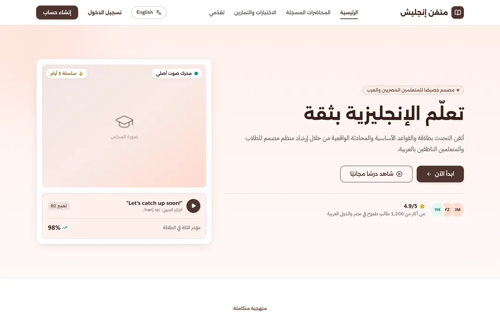
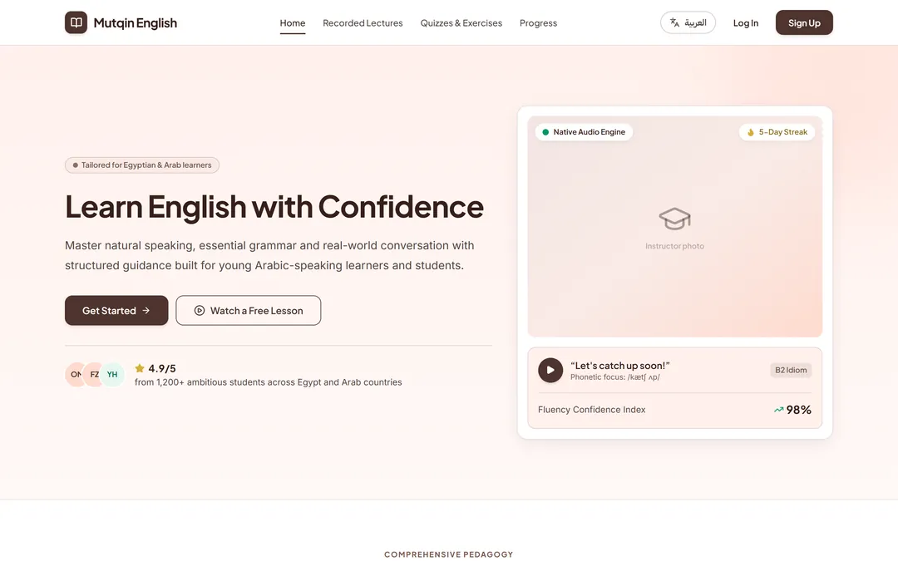
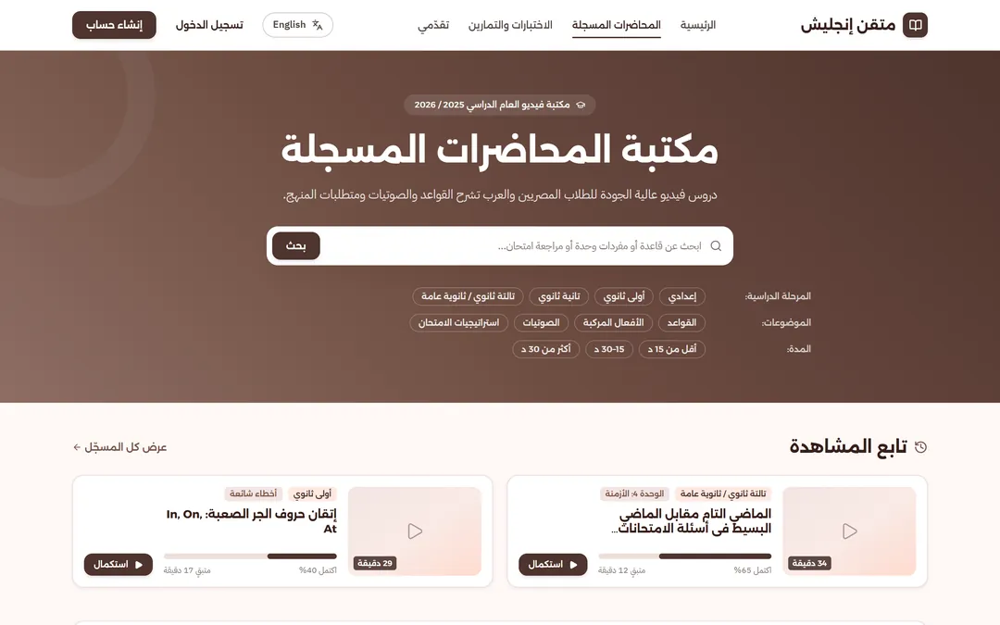
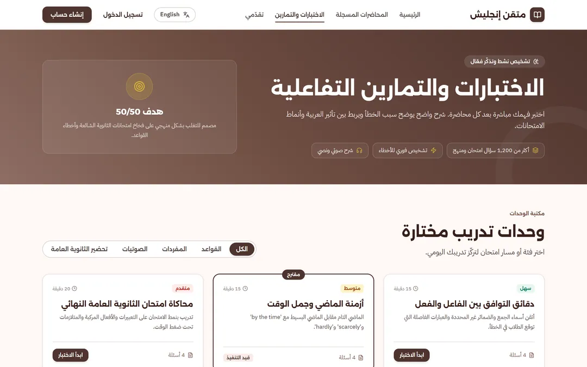
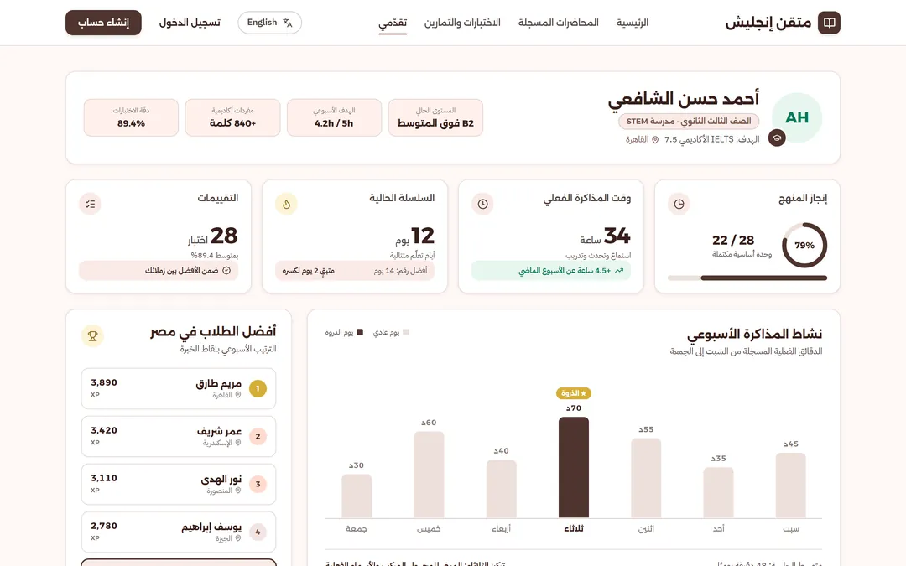
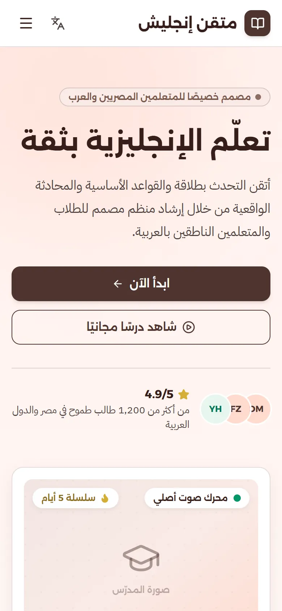
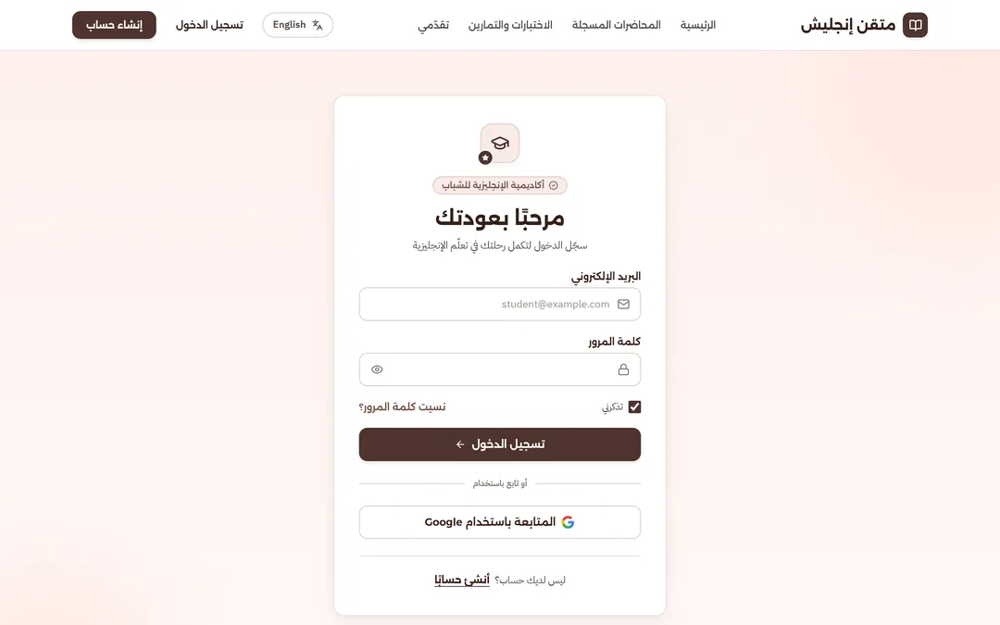

<div align="center">

# 🎓 أكاديمية مستر عادل مصطفى — Mr. Adel Mostafa Academy
### منصة تعليمية ذكية لإتقان اللغة الإنجليزية لطلاب الثانوية والشهادات العامة في مصر والعالم العربي
**Bilingual (EN / AR) • Angular 20 • Tailwind CSS • Standalone Components • Full RTL Engine**

---

[](https://mutqin-english.vercel.app)
[](https://mutqin-english.vercel.app)
[](https://github.com/13bod1/Mutqin-English/actions)
[](https://angular.dev/)
[](https://www.typescriptlang.org/)
[](https://tailwindcss.com/)

<br />

👉 **[🌐 تصفّح الموقع الحي مباشرة | Open Live Web App](https://mutqin-english.vercel.app)** 👈

</div>

---

## 📸 معمل الواجهات ولقطات الشاشة الحية (Visual Showcase)

جميع لقطات الشاشة مأخوذة بجودة **Retina 2x** مباشرة من بيئة الإنتاج الحية للموقع:

### 1. الصفحة الرئيسية (Landing Page — Arabic & English)
واجهة ترحيبية مصممة خصيصاً لهوية الطالب العربي مع دعم كامل للتبديل الفوري بين اللغتين بدون إعادة تحميل الصفحة:

| الواجهة العربية (RTL) | الواجهة الإنجليزية (LTR) |
| :---: | :---: |
|  |  |

---

### 2. مكتبة المحاضرات المسجلة (Recorded Lectures Catalog)
محرك فلترة ذكي حسب المرحلة الدراسية (إعدادي، أولى ثانوي، تانية ثانوي، تالتة ثانوي / ثانوية عامة)، والموضوعات (القواعد، الصوتيات، الأفعال المركبة)، ومدة المحاضرة، مع قسم **"تابع المشاهدة"** لحفظ تقدم الطالب:

<div align="center">
  
</div>

---

### 3. مركز الاختبارات والتمارين التفاعلية (Interactive Quizzes & Exercises)
اختبارات تشخيصية دقيقة تهدف لكسر فخاخ امتحانات الثانوية العامة مع شروحات فورية، مستويات صعوبة تدريجية، ومسارات تدريب مخصصة:

<div align="center">
  
</div>

---

### 4. لوحة تقدّم الطالب والشارت الأسبوعي (Progress Dashboard & Analytics)
لوحة متابعة أكاديمية متقدمة تتضمن حلقة إنجاز المنهج، ساعات المذاكرة الحقيقية، سلسلة الالتزام اليومية (Daily Streak)، ومخطط بياني لتوزيع نشاط المذاكرة على مدار الأسبوع، إلى جانب قائمة المتصدرين (Leaderboard):

<div align="center">
  
</div>

---

### 5. التجاوب الكامل مع الهواتف الذكية (Mobile Responsive & Authentication)

| تجربة الموبايل المتكاملة (Responsive 390px) | شاشة الدخول الموثقة (Secure Login) |
| :---: | :---: |
|  |  |

---

## ⚡ الميزات التقنية والمعمارية (Key Architectural Features)

- **⚡ أداء فائق وتوجيه SPA أحادي الصفحة:** مبني بالكامل على **Angular 20** مع معمارية Standalone Components و Vite/Application Builder فائق السرعة.
- **🌍 محرك تعريب ذكي وتوجيه ثنائي الاتجاه (BiDi / RTL First):**
  - خطوط محلية مدمجة عبر `@fontsource` لضمان سرعة التحميل دون الاعتماد على خوادم خارجية:
    - **العربية:** خط Alexandria للعناوين، و IBM Plex Sans Arabic للنصوص.
    - **الإنجليزية:** خط Plus Jakarta Sans للعناوين، و Inter للنصوص.
  - انعكاس كامل للأيقونات والتخطيط تلقائياً مع تحديث سمة `dir="rtl"` في وسم `<html>`.
- **🎨 نظام توكنات وتصميم معتمد على Figma:**
  - ألوان، ظلال، ومسافات متوافقة 100% مع مواصفات الـ Figma في `tailwind.config.js`.
  - مكونات CSS قابلة لإعادة الاستخدام (`btn`, `card`, `pill`, `chip`, `input`).
- **🔌 جاهزية تامة للربط الخلفي (Decoupled & Ready for Backend):**
  - جميع خدمات البيانات (`LectureService`, `QuizService`, `ProgressService`, `AuthService`) تعتمد على الـ `Observable` والواجهات المكتوبة بصرامة في `src/app/core/models/`.
  - الانتقال للـ Backend يتطلب فقط استبدال `mockResponse()` بـ `HttpClient`.

---

## 🚀 خط الإنتاج والاستضافة المشتركة للفريق (CI/CD & Collaboration)

تم ربط المستودع باستضافة سحابية عالية الأداء على **Vercel** عبر **GitHub Actions**:

### 👥 صلاحيات التعديل لكافة أعضاء المستودع:
1. **النشر التلقائي فور التعديل:**
   - بمجرد قيام أي عضو في الفريق بعمل `git push` أو دمج Pull Request على فرع `main`، يبدأ الـ Workflow ببناء المشروع ونشره خلال ~45 ثانية.
2. **روابط المعاينة المستقلة (Preview Deployments):**
   - أي فرع تجريبي أو Pull Request يحصل تلقائياً على رابط معاينة معزول لفحص التعديلات قبل دمجها.
3. **التحكم عبر `vercel.json`:**
   - ملف التوجيه وقواعد التوجيه (`rewrites`) متاح ومفتوح لأعضاء الفريق لتعديل أي سلوك خاص بالـ Routing أو الـ Headers بحرية كاملة.

---

## 💻 التشغيل والتطوير المحلي (Local Development)

```bash
# 1. تثبيت الحزم والتبعيات
npm install

# 2. تشغيل السيرفر المحلي للتطوير
npm start
# يفتح تلقائياً على http://localhost:4200

# 3. بناء نسخة الإنتاج
npm run build
```

---


---

## 🗄️ حزمة قاعدة البيانات المنفصلة (Standalone Database Package)

تتضمن المنصة حزمة معمارية متكاملة لقواعد البيانات العلائقية تحت المسار `database/standalone/` مع محول Python ثنائي المحرك يدعم التطوير المحلي المعزول ونشر الإنتاج:

```bash
# الانتقال إلى حزمة قاعدة البيانات
cd database/standalone

# تشغيل محول SQLite المعزول في الذاكرة وفحص الجداول الـ 21
python -c "from adapter.db_adapter import SQLiteDatabaseAdapter; db = SQLiteDatabaseAdapter(':memory:'); db.initialize_schema_sqlite(); print('Tables:', len(db.get_table_names())); db.close()"
```

- **هيكل الحزمة:**
  - `database/standalone/adapter/`: محول `db_adapter.py` لدعم SQLite محلياً و PostgreSQL 16+ إنتاجياً مع دوال UDF مسجلة.
  - `database/standalone/schema/`: مخطط الإنتاج الأساسي `01_mr_adel_production_schema_pg16.sql`.
  - `database/standalone/migrations/`: سكربتات الترحيل المتسلسلة `001` إلى `007`.
  - `database/standalone/rollback/`: سكربتات التراجع `001` إلى `007`.
  - `database/standalone/inventory/`: جرد الجداول والحقول ومصفوفة الحدود المعمارية.

---

## 🧪 اختبارات الجودة وفحص النظام (Testing & QA Instructions)

### 1. اختبارات الوحدة للواجهة الأمامية (Angular Unit Tests)
```bash
# تشغيل اختبارات Karma / Jasmine
npm test -- --watch=false --browsers=ChromeHeadless
```

### 2. اختبارات التكامل ونهاية إلى نهاية (Playwright E2E Tests)
```bash
# تشغيل سيناريوهات E2E الشاملة
npx playwright test
```

### 3. اختبارات حزمة قاعدة البيانات (Database Python Pytest)
```bash
# تشغيل اختبارات الحدود والصلابة الأمنية
python -m pytest db_subtasks/10_seeders_and_tests/ -v
```

### 4. خطط وسيناريوهات فحص الجودة (Sherry QA Test Plans)
- `qa/sherry/AG-72-admin-rbac-security-test-plan.md`: خطة فحص صلاحيات الأدمن والـ RBAC.
- `qa/sherry/AG-73-theme-popup-test-plan.md`: خطة فحص النافذة الترحيبية وتوافق الألوان.
- `qa/sherry/AG-74-announcements-test-plan.md`: خطة فحص شريط ونظام الإعلانات.
- `qa/sherry/AG-76-sprint-2-uat-script-mr-adel.md`: دليل الفحص التجريبي ومحضر اعتماد المالك (Sprint 2 UAT Runbook).

> **ملاحظة حالة الاعتماد والتسليم:**
> هذه النسخة تمثل مخرجات سباق التطوير الثاني (Sprint 2 Candidate). حالة المهام مسجلة كـ `UNVERIFIED_PENDING_FINAL_RUNS` في انتظار إتمام جولة الفحص النهائية الشاملة وجلسة مراجعة المالك الحية (Sprint 2 Review)، دون أي ادعاء غير مبرر للاعتماد النهائي أو الإغلاق التام لكافة المهام دون اعتماد بشري.

---

## 📂 هيكلية المشروع (Project Tree)

```text
src/app/
├── core/
│   ├── data/       # خدمات جلب البيانات (Services)
│   ├── i18n/       # قواميس الترجمة والـ Pipes ومحرك تبديل اللغات
│   ├── mock/       # بيانات تجريبية مطابقة لهيكل قواعد البيانات الحقيقية
│   └── models/     # واجهات TypeScript المعيارية
├── features/       # صفحات ومسارات التطبيق (Lazy-loaded Routes)
│   ├── auth/       # تسجيل الدخول وإنشاء الحساب
│   ├── landing/    # الصفحة الرئيسية الترحيبية
│   ├── lectures/   # مكتبة المحاضرات والفلترة ومشغل الفيديو
│   ├── progress/   # لوحة تحليلات وإحصاءات الطالب
│   └── quizzes/    # واجهة الاختبارات والتمارين التفاعلية
└── shared/
    ├── layout/     # الهيكل الأساسي (Shell, Header, Footer)
    └── ui/         # المكونات المشتركة (Buttons, Cards, Rings, Avatars)
```

<br />

<div align="center">
  <b>صُنِعَ بإتقان لدعم وتمكين طلاب الثانوية العامة والشهادات العربية 🌟</b>
</div>
